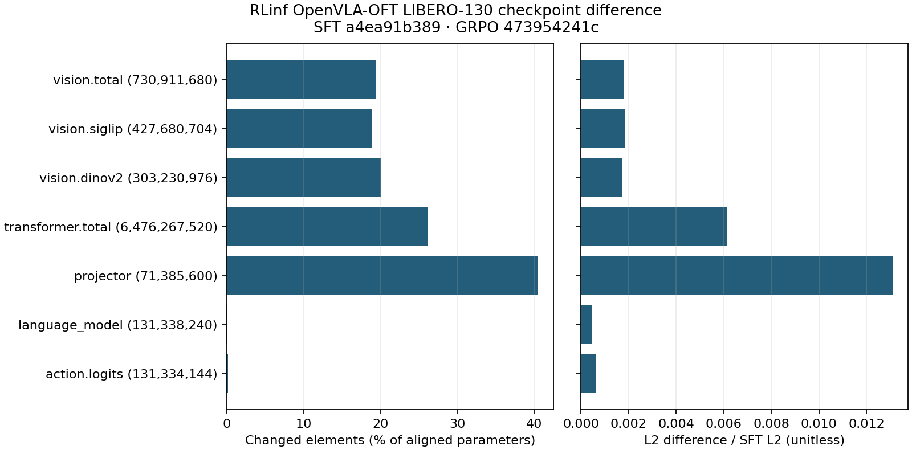

# R0 checkpoint and inference audit

**Overall state — PASS** · 2026-11-27 KST

| Stage | Status | Evidence |
| --- | --- | --- |
| R0-1 · Model structure | PASS on server4 | [Status](../../../outputs/research/R0/r0-1-20261127T050947Z-3098626/status.json) · [Structure and identities](../../../outputs/research/R0/r0-1-20261127T050947Z-3098626/structure.json) |
| R0-2 · Checkpoint differences | PASS on server4, evidence verified locally | [Status](../../../outputs/research/R0/r0-2-20261127T052515Z-3098626/status.json) · [Tensor and module results](../../../outputs/research/R0/r0-2-20261127T052515Z-3098626/comparison.json) · [Module CSV](../../../outputs/research/R0/r0-2-20261127T052515Z-3098626/modules.csv) |
| R0-3 · Hook equivalence | PASS on server4, evidence verified locally | [Status](../../../outputs/research/R0/r0-3-20261127T055218Z-3098626/status.json) · [SFT checks](../../../outputs/research/R0/r0-3-20261127T055218Z-3098626/sft-equivalence.json) · [GRPO checks](../../../outputs/research/R0/r0-3-20261127T055218Z-3098626/grpo-equivalence.json) |

SFT `Base-Lora@a4ea91b38976` and GRPO `LIBERO-130@473954241c81` use adapter-disabled native inference. The shared LM projection supplies 56 action-token slots, decoded to 8 × 7 actions. SFT’s published LoRA payload and historical trainable masks require separate provenance.

Across 982 aligned tensors at zero tolerance on stored values, 844 differed and 138 were identical. Five GRPO-only value-head tensors fell outside the loaded policy registry. Overall, 24.81% of 7.541 billion aligned elements differed. Changed fractions were 19.43% in vision (DINOv2 20.07%, SigLIP 18.98%), 40.52% in the projector, 26.24% in transformer blocks, and 0.183% in the shared LM projection. Weight changes establish snapshot differences. Training attribution and camera sensitivity remain separate questions.



*Figure regenerated locally from the verified server comparison. Fractions use aligned elements in each labeled module. Relative L2 uses the corresponding SFT norm.*

On saved observation `sft-libero_10-t05-i03-q0000`, both policies passed all 19 deterministic comparisons at zero tolerance. Processed inputs, 56 token IDs, and decoded 8 × 7 actions matched the no-hook prediction. The 56 × 256 raw action-bin logits matched the independent Phase 3B LM-output hook exactly, with max absolute difference 0. The native no-hook return exposes actions and tokens. Both repeated captures resolved all eight selected boundaries and passed the registration cleanup check. Coverage is one saved observation per policy under greedy inference. [Provenance](../../../outputs/research/R0/r0-3-20261127T055218Z-3098626/provenance.json)

Local CPU tests recorded 138 passed, 1 skipped, and 15 subtests passed. [CPU test log](../../../outputs/research/R0/r0-3-cpu-20261127/pytest.log)

## Reproduce on server4

```bash
cd /nfs6/jhkim/repos/rlinf
conda activate base
source "$PWD/upstream/RLinf/.venv-rlvr-libero-cu121/bin/activate"
export PYTHONPATH="$PWD/upstream/RLinf:$PWD"

r0_1=outputs/research/R0/r0-1-20261127T050947Z-3098626
r0_2=outputs/research/R0/r0-2-20261127T052515Z-3098626
checkpoints=/nfs4/jhkim/repos/rlinf/checkpoints

python -B -m scripts.research.cli.check_hook_equivalence \
  --r0-1 "$r0_1" --r0-2 "$r0_2" --checkpoint-root "$checkpoints" \
  --run-id "r0-3-$(date -u +%Y%m%dT%H%M%SZ)-$$"
```

To reproduce the CPU comparison, use `python -B -m scripts.research.cli.compare_checkpoints --r0-1 "$r0_1" --checkpoint-root "$checkpoints" --run-id "r0-2-$(date -u +%Y%m%dT%H%M%SZ)-$$"`.

**Next experiment** — R1 Camera pair construction.

**2026-11-27** — Verified the server R0-2 results and added the R0-3 replay and hook checks.

**2026-11-27** — Verified server4 R0-3 evidence, including direct equality and greedy-token reconstruction from the saved logit arrays. Closed R0 as PASS.
