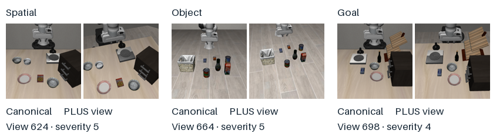

# R1 — Camera Pair & Tensor Capture

**Overall · PASS** · 2026-11-27 KST · `r1-capture-20261127T063211Z-3098626`

| Gate | Status | Evidence |
| --- | --- | --- |
| R1-1 · Pair alignment | PASS | [27 same-state pairs, 36 views](../../../outputs/research/R1/r1-capture-20261127T063211Z-3098626/dataset.json) |
| R1-2 · Tensor capture | PASS | [36 captures per policy](../../../outputs/research/R1/r1-capture-20261127T063211Z-3098626/captures.json) |
| R1-3 · Action regression | PASS | [SFT R0 replay](../../../outputs/research/R1/r1-capture-20261127T063211Z-3098626/sft-r0-regression.json) · [GRPO R0 replay](../../../outputs/research/R1/r1-capture-20261127T063211Z-3098626/grpo-r0-regression.json) · [54 pair comparisons](../../../outputs/research/R1/r1-capture-20261127T063211Z-3098626/comparisons.json) |
| R1-4 · Offline validation | PASS | Copied run revalidated locally with `PASS 27 pairs and 36 observations per model`. [Run seal](../../../outputs/research/R1/r1-capture-20261127T063211Z-3098626/status.json) |

**Dataset.** Spatial, Object, and Goal each contribute three saved initial states and four views per settled state. Each pair shares exact simulator time, robot/object state, and controller configuration, with distinct RGB. The views replay official PLUS camera geometry in the same simulator after 15 settling steps. The official evaluator uses its own reset semantics. The capture reused the 36 original observation files from `r1-pairs-20261127T062618Z-3098626`. [Parent run provenance](../../../outputs/research/R1/r1-capture-20261127T063211Z-3098626/provenance.json)

**Inference.** SFT `Base-Lora@a4ea91b38976` and GRPO `LIBERO-130@473954241c81` passed deterministic R0 replay. Hooked and no-hook tokens and actions matched exactly, and each saved 56 × 256 action-logit slice reconstructed its 56 greedy tokens. Across the 27 ID/OOD pairs, 334 of 1,512 SFT token positions and 411 of 1,512 GRPO positions differed. These are descriptive counts for the selected smoke cases.



*Trial 0, highest selected severity per task. Each canonical and PLUS image pair shows the same settled physical state. Images are the RGB bytes used by the policy after RLinf's image rotation.*

## Reproduce

From the server4 repository root with the R0-3 RLinf Python environment:

```bash
export PYTHONPATH="$PWD:$PWD/upstream/RLinf${PYTHONPATH:+:$PYTHONPATH}"
run_id="r1-capture-$(date -u +%Y%m%dT%H%M%SZ)-$$"
python -B -m scripts.research.cli.capture \
  --r0-3 outputs/research/R0/r0-3-20261127T055218Z-3098626 \
  --pairs-from outputs/research/R1/r1-pairs-20261127T062618Z-3098626 \
  --checkpoint-root /nfs4/jhkim/repos/rlinf/checkpoints --run-id "$run_id" &&
python -B -m scripts.research.cli.validate "outputs/research/R1/$run_id"
```

**Next.** Reuse the sealed R1 artifacts as inputs for R2 when authorized. Camera robustness and causal effects were outside this smoke test.
